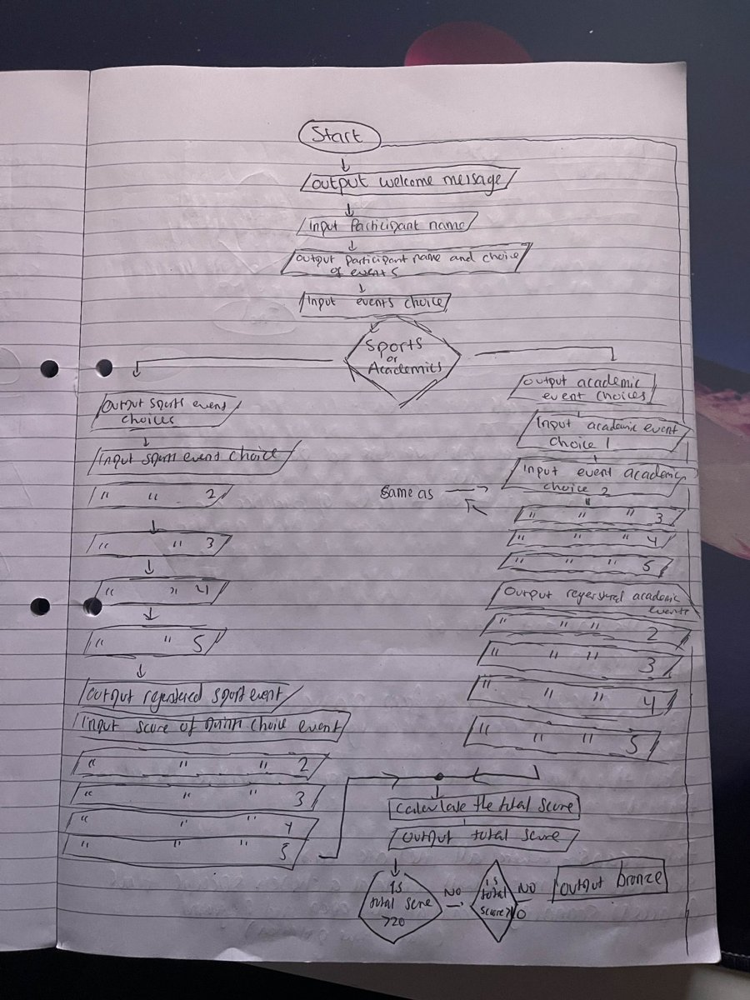
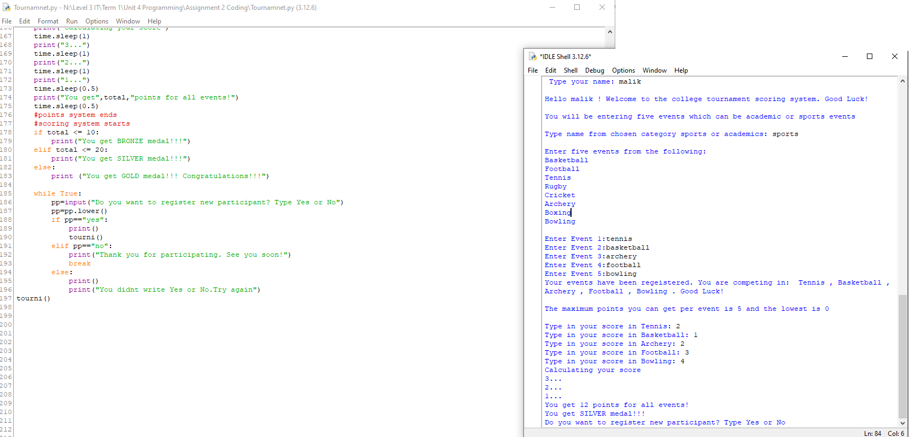

# Unit 4: Programming

**Language:** Python &nbsp;·&nbsp; **Code:** [tournament.py](../projects/tournament-scoring/tournament.py)

**The brief:** a college asked me to write a scoring program for its tournament. Each participant enters their name, chooses sports or academic events, picks five events, and gets 0–5 points for each. The program totals the points and awards a Bronze, Silver or Gold medal.

## Planning

 My hand-drawn flowchart of the program

Before coding, I:

- wrote a **requirements table** listing each requirement's input, process and output;
- drew **flowcharts** and **storyboards** of each screen;
- planned which structure to use for each part (variables, `if`/`elif`/`else`, loops);
- wrote a **test plan** with normal, extreme and abnormal test data.

## The program

 The finished program running in Python IDLE

How it works:

1. **Name:** asks for the participant's name and won't continue until one is entered (presence check).
2. **Category:** asks for `sports` or `academics` and keeps asking until it gets one of the two. Input is converted to lowercase, so `Sports` works too.
3. **Events:** shows the list for that category and asks for five events. Each must be on the list (lookup check), and each is capitalised so it displays neatly.
4. **Scores:** asks for a score for each event and rejects anything outside 0–5 (range check).
5. **Result:** adds up the total, counts down 3…2…1, then awards **Bronze** (10 or less), **Silver** (20 or less) or **Gold** (above 20).
6. **Again?:** asks whether to register another participant and restarts or ends.

## Testing

| Test | Type | Expected | Result |
|---|---|---|---|
| Participant enters a valid name and events | Normal | Program continues | ✅ Pass |
| Total points decide the medal | Normal | Bronze, Silver or Gold shown | ✅ Pass |
| Score of 0 | Extreme | Accepted | ✅ Pass |
| Score of 8 | Extreme | Rejected, asked to retry | ✅ Pass |
| Event that isn't on the list | Abnormal | Rejected, asked to retry | ✅ Pass |

## Error log

I kept a log of the errors I hit and how I fixed them:

| # | Error | Fix |
|---|---|---|
| 1 | A stray letter outside a `print` statement | Removed it |
| 2 | Missing commas between variables in a `print` | Added the commas |
| 3 | The program didn't start | Added the `tourni()` call at the end |
| 4 | `while` loop at the wrong indentation | Re-indented it to line up with the code around it |
| 5 | `UnboundLocalError`: typed `ee6` instead of `ee2` | Renamed the variable to `ee2` |
| 6 | Unclosed bracket in a `print` statement | Added the closing bracket |

Indentation errors caused me the most trouble, which taught me how strictly Python relies on indentation.

## What I'd improve

- A **leaderboard** comparing everyone's scores
- A **confirmation step** so participants can change their events before scoring
- A **graphical interface**
- **Loops and functions** for the five events, instead of repeating the same block five times

> **About the code:** I didn't keep the original `.py` file, so [tournament.py](../projects/tournament-scoring/tournament.py) has been typed up line for line from the code screenshots in my assignment, typos included. It runs and gives the same results as the screenshots.

---

<a href="unit-12-it-technical-support.md">← Unit 12: IT Technical Support and Management</a> &nbsp;·&nbsp; <a href="../README.md#units">All coursework</a> &nbsp;·&nbsp; <a href="unit-06-website.md">Unit 6: Website development →</a>

