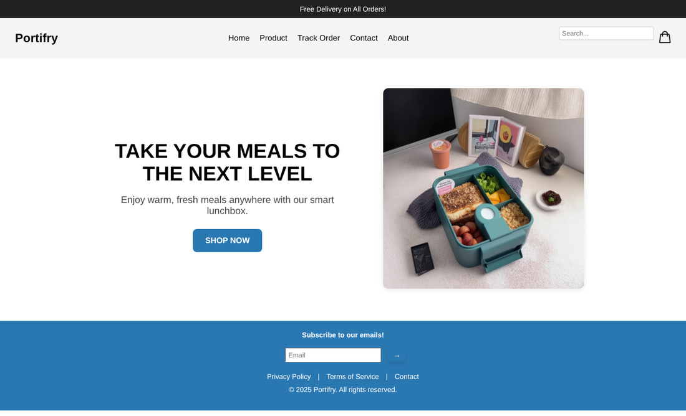
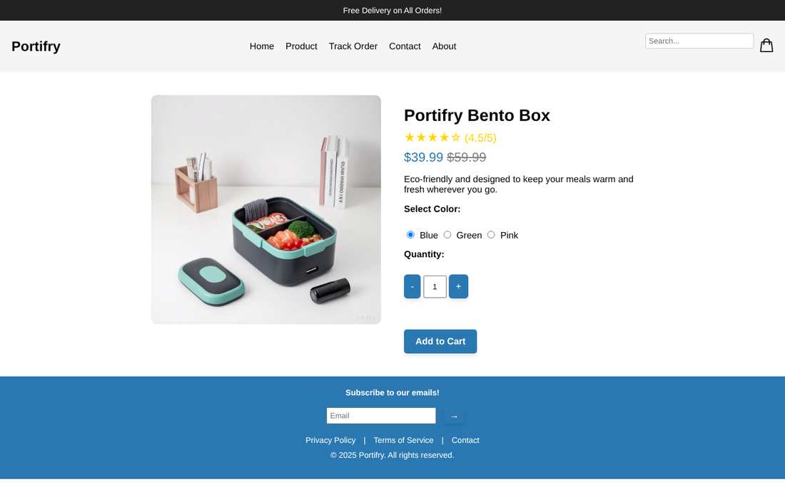
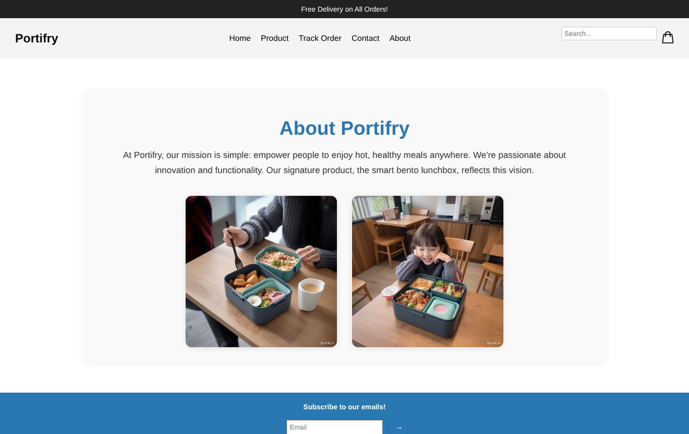

# Unit 6: Website development

**Grade:** Distinction &nbsp;·&nbsp; **Built with:** HTML, CSS and JavaScript in Notepad++ &nbsp;·&nbsp; **Code:** [portifry-website](../projects/portifry-website/)

**The brief:** design and build a website for my own business idea, **Portifry**, an online-only brand selling a smart bento lunchbox that keeps meals warm. The client wanted:

- a clean, minimal, professional look that matched the brand;
- clear navigation, and contact details;
- a mobile-friendly site that loads fast;
- the whole thing done in **two weeks**, ready for a product launch.

## The website

 Home page

 Product and About pages

It has six pages: **Home, Product, Track Order, Contact, About and Cart**. Each page shares:

- a delivery banner, a navigation bar, a search box and a cart icon;
- a footer with an email sign-up and the links.

## How I built it

- **HTML:** a separate file for each page, linked through the nav bar, with forms for Contact and Track Order.
- **CSS:** one shared [style.css](../projects/portifry-website/style.css) for layout (flexbox), the blue, black and white colour scheme, and hover effects that zoom images and darken buttons.
- **JavaScript:** [script.js](../projects/portifry-website/script.js) makes **Add to Cart** work. It saves the item, colour and quantity in the browser's `localStorage`, and clicking the cart icon shows a preview of what's in the cart.

## Process

1. **Planning:** I wrote client and user requirements, a site structure diagram, wireframes for every page, and alternative designs.
2. **Testing:** I ran a 10-point test plan (navigation, footer, hover effects, colours, buttons, images, fonts and the cart). The cart failed at first, so I learned JavaScript to make it work.
3. **Peer feedback:** classmates suggested centring the Track Order and Contact pages, making the About page consistent, and adding a working Add to Cart button and cart dropdown. I made those changes.
4. **Evaluation:** I reviewed the finished site against the client and user requirements.

## What I learned

- **Plan the structure first.** Wireframes made building each page much faster.
- **One shared stylesheet** keeps every page consistent and makes changes quick.
- **Some features need JavaScript.** HTML and CSS handle layout, but anything interactive, like the cart, needs scripting.
- **I taught myself as I went.** I had little web development experience before this unit, so much of it was self-taught under a tight deadline.

## Not finished yet

The search box, the checkout, order tracking and the email sign-up are front-end only: they look right but aren't connected to anything. The cart page shows a fixed example item, and the product page and cart use different prices.

> Product photos were made with an AI image generator (Kling AI) as mock-ups of the product.

---

<a href="unit-04-programming.md">← Unit 4: Programming</a> &nbsp;·&nbsp; <a href="../README.md#units">All coursework</a>

