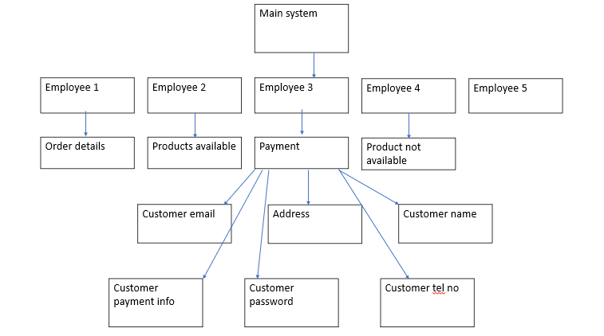
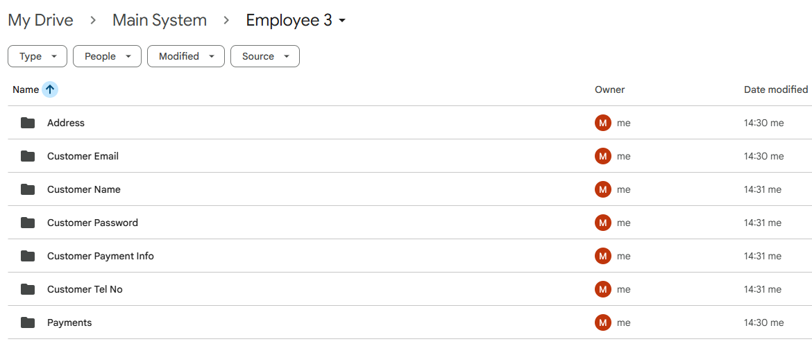
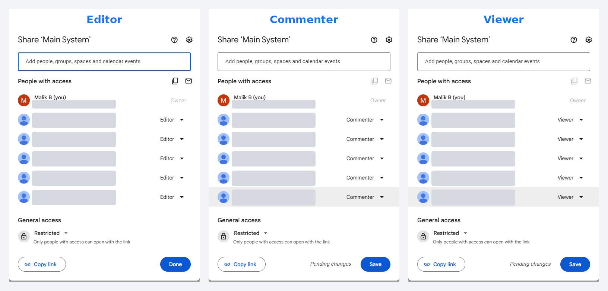
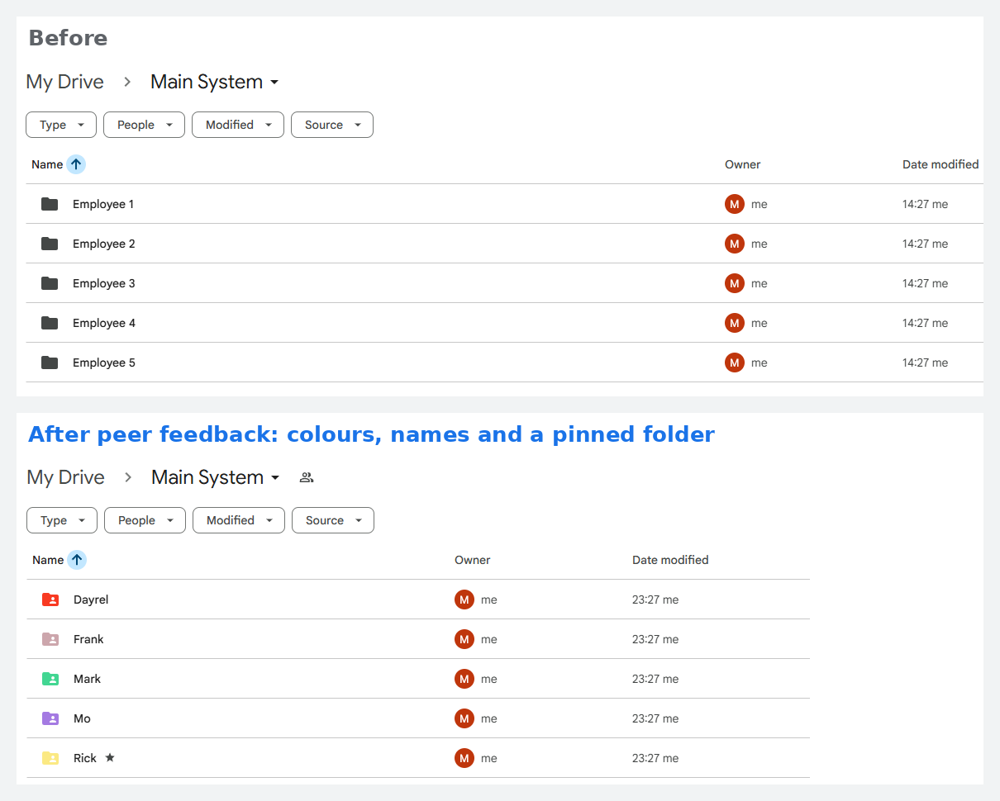
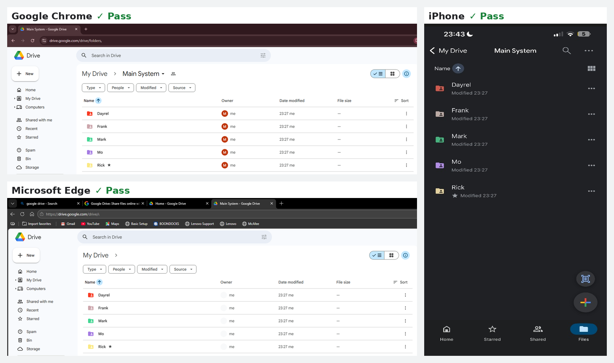
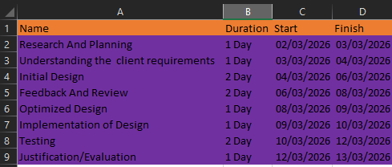
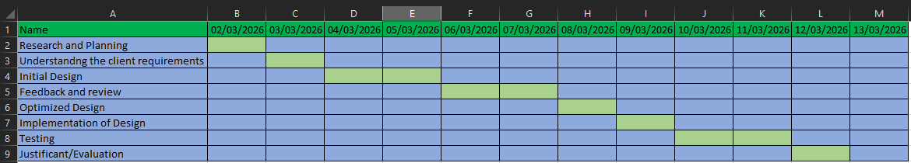

# Unit 16: Cloud computing

**Grade:** Distinction &nbsp;·&nbsp; **Assignments:** 2

**The brief:** I'd joined the IT department of a medium-sized company whose data and applications all sit on physical servers at head office. The IT director wanted to know how cloud technology could help.

- **Assignment 1:** a report on how cloud technology can be used in an organisation.
- **Assignment 2:** design, build, test and review a cloud storage system for five employees so they can share files and collaborate.

## Assignment 2: Building a cloud storage system

I built the system in Google Drive: a **Main System** folder with a folder for each of the five employees, holding the records they work with, such as order details, products available, payments and customer details.

### 1. Planning the folder structure

 My folder plan. Reviewing it showed Employee 5 wasn't linked to anything.

I mapped out the structure before building it. Reviewing the plan picked up two gaps: Employee 5 wasn't connected to the rest of the system, and shipment details weren't linked to the staff handling deliveries, which would make lost or late parcels hard to trace.

### 2. Building it

 Inside one employee's folder: My Drive › Main System › Employee 3

I created the folders in Google Drive and opened every employee folder in Microsoft Edge, Google Chrome and on an iPhone to check the structure matched the plan.

### 3. Setting permissions

 The three permission levels I set up. Email addresses are hidden.

I shared the Main System folder with five accounts and set them up with each of Google Drive's three permission levels: **Editor**, **Commenter** and **Viewer**. General access stayed **Restricted**, so only people added can open it, even with the link.

### 4. Acting on peer feedback

 Before and after the three feedback changes

Classmates reviewed the system and suggested three changes, which I made:

1. **Colour-code the folders** so each employee's is easy to spot.
2. **Pin an important folder** (starred) so it's quick to find.
3. **Rename the folders** from Employee 1–5 to the employees' names.

### 5. Testing compatibility

 The finished folder open in Chrome, Edge and on an iPhone

| Test | Result |
|---|---|
| Folder opens in Google Chrome | ✅ Pass |
| Folder opens in Microsoft Edge | ✅ Pass |
| Folder opens on an iPhone | ✅ Pass |

### 6. Maintenance, planning and risks

- **Maintenance log:** I recorded routine checks: when files were last modified, who files are shared with and who has access, shortcuts, pinning, and filtering by file type.
- **Gantt chart:** I planned the project in eight stages over two weeks, from research and planning to testing and evaluation.

 

- **Risks:** I assessed six risks and how to reduce each one:

| Risk | How to reduce it |
|---|---|
| Unauthorised access | Strong passwords and multi-factor authentication (MFA) |
| Password and login problems | A password policy: complex passwords, regular changes, no reuse |
| Data theft | Tight access permissions and monitoring for unusual activity |
| Data loss | Regular backups and a disaster recovery plan |
| Login issues | Keep systems updated; backup sign-in methods such as recovery codes |
| Accidental permissions | Least privilege and regular permission reviews |

### My evaluation

- **What worked:** each employee has their own organised folder that others can share and work in, and it works the same in Chrome, Edge and on a phone. Permission levels reduce the chance of someone changing files by accident, and the feedback changes made it easier to navigate.
- **Limitations:** it depends on a working internet connection, and a cloud system is still a target for unauthorised access, so strong passwords, MFA and monitoring matter.
- **What I'd add next:** automated backups and activity logs, and shared calendars or project tracking for the team.

## Assignment 1: How cloud technology can be used in an organisation

A report of about 7,000 words, written for the IT director of a manufacturing company. For each topic I explained it and weighed up the advantages and disadvantages for the business:

- **Characteristics of cloud computing:** on-demand self-service, ubiquitous access, resource pooling, measured service and rapid elasticity
- **Service models:** SaaS, PaaS and IaaS, plus virtualisation
- **Deployment models:** public, private, hybrid and community clouds; self-hosted versus third-party services
- **Other features:** automation, cloud bursting, just-in-time service and multi-tenancy
- **Impact on organisations:** the implications of moving to the cloud, and the legal requirements

## What I learned

- **Plan before you build.** Reviewing the folder plan caught gaps before anything was set up.
- **Give people only the access they need.** Viewer, Commenter and Editor exist so users can't change what they shouldn't, which is least privilege in practice.
- **Test on everything users will use.** Checking two browsers and a phone confirmed it worked for everyone.
- **Small usability changes help.** Colours, clear names and pinning made files quicker to find.

---

<a href="../README.md#units">All coursework</a> &nbsp;·&nbsp; <a href="unit-12-it-technical-support.md">Unit 12: IT Technical Support and Management →</a>

